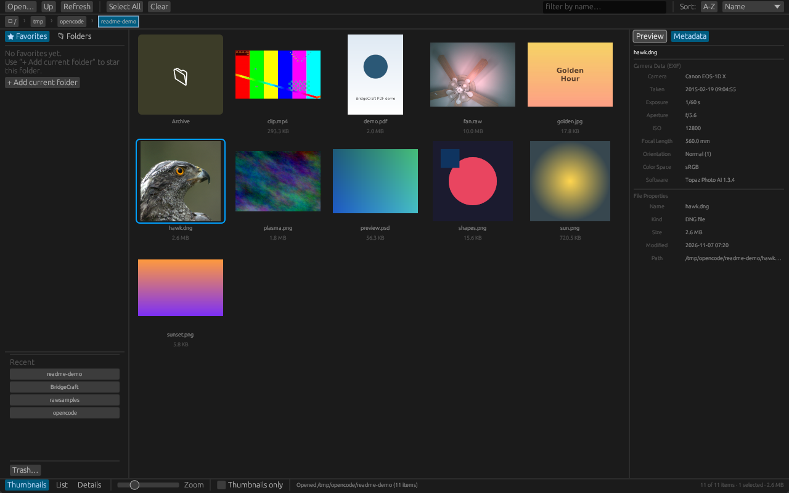

<div align="center">

# BridgeCraft

**Browse every asset you own — one fast, native, cross-platform browser for images, video, PDFs, and camera RAW, written entirely in Rust.**

A clean-room, from-scratch asset browser inspired by the workflows of classic digital-asset tools.

[](https://github.com/cmspeedau/BridgeCraft/actions/workflows/ci.yml)


</div>



> **Status:** pre-1.0, under active development. Foundations (Phase 0) and thumbnails & previews (Phase 2) are **complete**; the browsing core (Phase 1) is done apart from outbound OS drag and hardening, on the Bridge-style workspace shell. Also shipped: the metadata panel with its rating, label, flag and keyword editor, batch rename, batch export with a jobs list, watched-folder automation, and the WASM plugin layer with its manager dialog. There are no installers yet; build from source (below). A few engines are still ahead of their UI (contact sheets, publish presets, metadata templates, smart collections and version stacks: working code in `bc-core`/`bc-metadata`, nothing to click yet), and those are the best contributor targets: see the [issue backlog](https://github.com/cmspeedau/BridgeCraft/issues/19) and the honest per-item state in [ROADMAP.md](ROADMAP.md).

## Everything in the box

| Area | What works today |
|---|---|
| **Browse** | Folder navigation with breadcrumb chips, favorites sidebar (persistent), folders tree, recent folders, filter-as-you-type, sort by name/size/date **and by rating, colour label or flag**, plus a Tags filter (rating floor, label, flag) that reads the metadata index rather than opening every file |
| **Search** | A library search box over the metadata index: one or more words matched against file name and path, keywords, title, description and camera make/model, scoped to this folder, this folder and subfolders, or the whole library. Results replace the grid and sort, filter and tag like any other listing; Esc or ✕ leaves the search. Runs on a background thread and says how many files in the scope the index has not read yet, because those cannot match |
| **Collections** | A search worth repeating can be saved by name in the sidebar's Collections tab ("◎ Collections"). The list shows what each one will ask for; clicking it runs it and puts the results back in the grid with the scope it was saved with; ✕ deletes it. Saving over an existing name replaces that collection, and the button says so first. What can be authored today is words plus a scope — the stored format supports richer rules, and an editor for them is the open half |
| **Views** | Thumbnail grid with zoom slider (label dot and star rating on rated items), list with a label dot, and details table with Name, Type, Size, Modified, Rating and Label columns; "thumbnails only" mode |
| **Select** | Click / ctrl-toggle / shift-range / select-all; drag the selection onto a folder to move it (hold Alt to copy); drop files from the desktop to copy them into the folder under the pointer; right-click menu with copy, move, single-file rename, token-based batch rename with preview/apply and undo, trash & restore, permanent-delete confirm |
| **Previews** | Instant 256 px thumbnails; click any file for a live 2048 px preview in the side panel; double-click for the full zoom viewer (100% = on-demand native decode) |
| **Metadata** | Metadata panel for the selected file: star rating, color label, approve/reject flag and keyword chips, plus editable description, artist, copyright, make, model, software and date taken. Tags and text fields are written in place for JPEG and TIFF, and to the `.xmp` sidecar for RAW and PNG; when a sidecar already exists it is kept in sync in the same save. The same tags can be stamped across a selection, per property. Reading covers EXIF, IPTC-IIM, the XMP packet embedded in the file and the sidecar, merged lowest to highest priority (EXIF, IPTC, embedded XMP, sidecar), so tags another application put in the file show up with no sidecar involved. A read-only Camera Data (EXIF) block above the editable fields covers camera, taken, exposure, aperture, ISO, focal length, orientation, colour space, software, dimensions and GPS (JPEG, TIFF/DNG, both byte orders) |
| **Formats** | PNG, JPEG, TIFF, GIF, WebP, BMP, PSD (embedded previews), PDF-compatible AI — always; video, PDF, camera RAW when a local decoder is present (see below) |
| **Speed** | SQLite thumbnail cache keyed by `(path, size-tier)`, invalidated on file change; virtualized grid; background decode worker |
| **Live** | Watched folders auto-refresh; cache survives restarts; `--rebuild-cache` CLI for batch warm-up |
| **Export** | Right-click → Export…: batch resize/convert to JPEG (quality knob), PNG or WebP as a background job — non-modal job list with per-file progress, cancellation, collision-safe `basename_<max edge>.<ext>` naming, and no half-written files |
| **Automation** | Status-bar **Auto** opens watched-folder rules with configurable settle time, extension/size filters, thumbnail/rename/export/dated-move actions, bounded workers and persisted history |
| **Automation & plugins** | Local manifest-based WASM scripts use the shared `wasmi` sandbox with fuel and memory limits, default-deny persisted capability/filesystem grants, and a permissioned host API; local plugins add manager UI and granted menu/context/batch actions. No WASI or network host functions; declared panels are placeholders. |
| **PhotoCraft** | Right-click → Edit in PhotoCraft opens selected files in the installed PhotoCraft desktop app. Configure its executable with `PHOTOCRAFT_PATH` or the PhotoCraft settings window. |
| **LightCraft** | Right-click → Edit in LightCraft imports selected files into the installed LightCraft photo library. Configure its executable with `LIGHTCRAFT_PATH` or the LightCraft settings window. |

### Preview & zoom viewer

The zoom viewer escalates through three quality tiers: the grid thumbnail, a cached 2048 px preview, and — when you ask for 100% — an on-demand native-resolution decode (capped at 8192 px / 64 MP so a huge file can't stall the app).

| Key | Action |
|---|---|
| `← / →` | Previous / next file (selection stays in sync) |
| `+ / −` or `Ctrl`+scroll | Zoom (2%–1600%) |
| `0` | Fit to window |
| `1` | 100% (triggers the full-resolution decode) |
| Drag | Pan when zoomed in |
| Double-click | Reset to fit |
| `Esc` | Close |

## Batch export

Right-click a selection (or a single file) and choose **Export…**: pick a
destination folder (or leave it beside the originals), a format, and a
maximum long edge. The job runs on a bounded worker pool in the background
(default: half your cores) — the **Jobs** list in the status bar shows one
progress row per file with a done/failed summary, and browsing stays fully
usable while it runs.

Guarantees and current trade-offs:

- Outputs are named `basename_<max edge>.<ext>` (`photo_1024.jpg`) and never
  overwrite: collisions get `_1`, `_2`, … suffixes. Bytes land via a temp
  file plus rename, so a cancelled or failed export can never leave a
  truncated file behind.
- **Exports carry the asset's judgements, not its exposure.** A JPEG export gets
  the rating, colour label, approve/reject flag and keywords as an embedded XMP
  packet. Camera data (make, model, software, date taken) is deliberately not
  copied: an export is a downscaled re-encode, so repeating those tags would
  claim a provenance the output does not have. PNG and WebP exports carry no
  tags yet, because this build has no XMP writer for those containers and the
  storage policy forbids dropping surprise sidecars next to your exports; the
  dialog says which is which before the job starts.
- **EXIF orientation is applied to the exported pixels**, not copied as a tag.
- Camera RAW, PDF, video and Illustrator/PSD sources go through the same
  decode path as thumbnails, so they **export at thumbnail quality** for
  now; plain raster formats export at full resolution up to your chosen
  max edge.
- WebP is lossless (VP8L) with alpha preserved; JPEG flattens transparency
  onto white; PNG keeps alpha.
- Downscaling only: sources smaller than the max edge are not upscaled.

## Under the hood

| Crate | Purpose |
|---|---|
| `bc-core` | Filesystem scanning, directory watching, selection model, favorites & recents, trash bin, file operations, queued batch-export pipeline, background metadata indexer (same pool, same job list) |
| `bc-metadata` | EXIF read/write (JPEG/TIFF), IPTC-IIM read/write, XMP sidecar read/write, hierarchical keywords, ratings & labels |
| `bc-thumbnails` | SQLite-backed cache plus decoders: `image` (PNG/JPEG/TIFF/GIF/WebP/BMP), PSD embedded previews, Illustrator, and runtime-bound ffmpeg / pdfium / LibRaw paths |
| `bc-ui` | egui/eframe frontend: the workspace above, virtualized grids, the zoom viewer |

The layout deliberately targets the familiar asset-browser workspace (sidebar · grid · preview panel) that tools like Adobe Bridge made standard — implemented from scratch from public behavior descriptions, per the [clean-room policy](CLEANROOM.md). Decoders that carry restrictive or optional licenses (ffmpeg, Pdfium, LibRaw) are **never bundled or linked**: BridgeCraft binds to a copy you already have, and everything degrades gracefully when one is absent.

## Getting started

```sh
git clone https://github.com/cmspeedau/BridgeCraft
cd BridgeCraft
cargo run --release -p bc-ui -- /path/to/your/photos
```

The build toolchain is pinned in `rust-toolchain.toml`; rustup installs it (with `rustfmt` and
`clippy`) on first command. No minimum supported Rust version is claimed yet: the pinned toolchain
is what we build and test with, not a verified lower bound.

Thumbnails cache into `.bridgecraft-thumbs.db` in the working directory (still — moving that is open work). BridgeCraft's own state lives in the per-user data directory: favourites, recents, trash, plugins, version stacks and the metadata search index (`metadata.sqlite`) under `~/.local/share/BridgeCraft` on Linux, `~/Library/Application Support/BridgeCraft` on macOS and `%APPDATA%\BridgeCraft` on Windows; the watched-folder rules are the one thing kept in the *configuration* directory instead (`~/.config/BridgeCraft/auto-rules.json`). Opening a folder queues a background pass that writes each file's rating, label, flag, keywords and camera fields into that index, so a second visit to the same folder reads nothing that has not changed. Sorting or filtering the grid by rating, label or flag reads that index — one range query per folder, measured at 1.3 µs per file against 14.9 µs to parse each file's metadata — and saving a tag updates its row immediately, so the starred photo moves without waiting for a pass. What still reads files directly is the metadata **panel** and the rating badge on each visible cell: those check the file's own modification time, which means they can never show a tag you have already changed elsewhere, and one indexed lookup is actually *slower* (98 µs) than parsing the file. The free-text search field and smart-collection browsing are the next work.

Optional runtimes unlock more formats:

| Enable by installing | Gets you |
|---|---|
| `ffmpeg` on `PATH` | Video thumbnails (MP4, MOV, MKV, WebM, …) |
| `libpdfium` (+ `PDFIUM_PATH` if non-standard) | PDF page thumbnails, PDF-compatible `.ai` |
| `libraw` (+ optional `LIBRAW_PATH`) | Camera RAW thumbnails (CR2/CR3/NEF/ARW/DNG/…), preferring the camera's embedded preview |

Without them, those files simply show a placeholder and everything else works.

To warm the cache for a big library before first use:

```sh
cargo run --release -p bc-ui -- --rebuild-cache /path/to/library
```

## Roadmap

The long-term goal is a complete clean-room replacement for classic digital-asset workflows. Issues #5–#19 (Phase 3 metadata engine, Phase 4 batch and automation) are closed, but several were closed on **engine completion**: the code exists in `bc-core`/`bc-metadata` and has no UI yet. ROADMAP.md now marks those items `[~]` and names the missing caller for each, so the remaining work is visible: ratings/labels/keyword editing, contact-sheet and publish-preset actions, smart-collection browsing, metadata templates, version stacks, and the scripting window. Phase 4 tracking continues in [#20](https://github.com/cmspeedau/BridgeCraft/issues/20). Full plan: [ROADMAP.md](ROADMAP.md).

## Contributing

Contributions are welcome: see [CONTRIBUTING.md](CONTRIBUTING.md) first, every contributor signs a one-time clean-room attestation, and `cargo build/test/clippy/fmt` on the workspace must pass. Good starting points are the unwired engines listed above, in rough order of size: metadata templates (`bc-metadata::templates`, persistence and tests done, no caller), contact sheets (`bc-core::contact_sheet`), publish presets (`bc-core::publish`), version stacks (`bc-core::version_stacks`), and a search field plus smart-collection browsing over the index in `bc-core::metadata_index`. The ratings/label/keyword editor and internal drag & drop shipped on 2026-11-15, so they are no longer open.

## Releases & packaging

Planned release targets: a macOS universal 2 build, Windows portable ZIP + MSI installer, and a Linux AppImage with `.zsync` delta updates — signed by user decision **not** to code-sign, so expect Gatekeeper/SmartScreen prompts on first launch (details in the [roadmap risks](ROADMAP.md)).

## License

Apache-2.0. Third-party runtime notices are tracked in `THIRD_PARTY_LICENSES.md`.

---

*BridgeCraft is an independent project. It contains no Adobe code, assets, or trademarks, and is not affiliated with, endorsed by, or sponsored by Adobe Inc. “Adobe” and “Adobe Bridge” are trademarks or registered trademarks of Adobe Inc. in the United States and/or other countries.*
