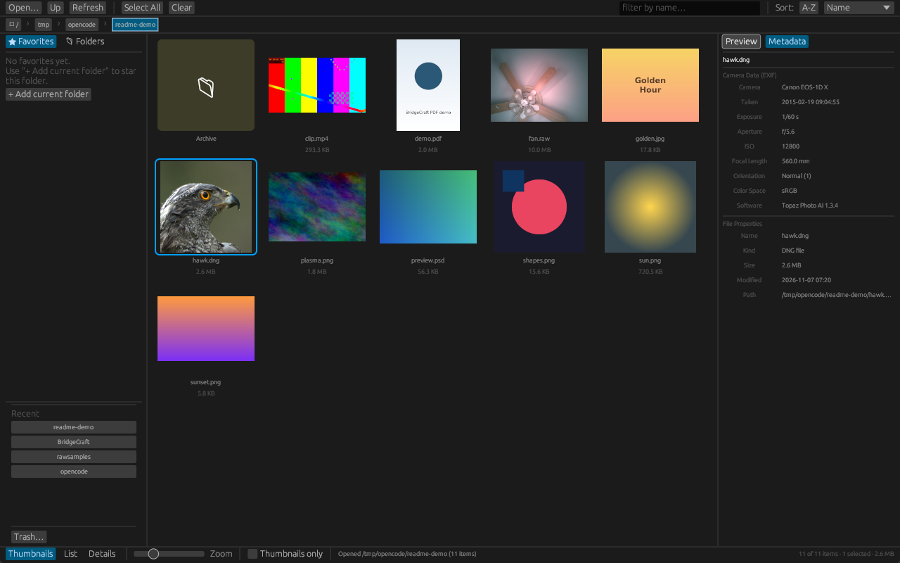

<div align="center">

# BridgeCraft

**Browse every asset you own — one fast, native, cross-platform browser for images, video, PDFs, and camera RAW, written entirely in Rust.**

A clean-room, from-scratch asset browser inspired by the workflows of classic digital-asset tools.

[](https://github.com/cmspeedau/BridgeCraft/actions/workflows/ci.yml)


</div>



> **Status:** pre-1.0, under active development. Foundations (Phase 0) and thumbnails & previews (Phase 2) are **complete**; the browsing core (Phase 1) is done with hardening in progress, now on a new Bridge-style workspace shell. There are no installers yet — build from source (below). Phase 3 (metadata) and Phase 4 (batch operations) are open for contributors: see the [issue backlog](https://github.com/cmspeedau/BridgeCraft/issues/19).

## Everything in the box

| Area | What works today |
|---|---|
| **Browse** | Folder navigation with breadcrumb chips, favorites sidebar (persistent), folders tree, recent folders, filter-as-you-type, sort by name/size/date |
| **Views** | Thumbnail grid with zoom slider, list, and details table; "thumbnails only" mode |
| **Select** | Click / ctrl-toggle / shift-range / select-all; right-click menu with copy, move, single-file rename, token-based batch rename with preview/apply and undo, trash & restore, permanent-delete confirm |
| **Previews** | Instant 256 px thumbnails; click any file for a live 2048 px preview in the side panel; double-click for the full zoom viewer (100% = on-demand native decode) |
| **Metadata** | Metadata panel for the selected file — editable description, artist, copyright, make, model, software and date taken (saved in place for JPEG/TIFF, XMP sidecar for RAW), plus read-only camera/exposure/GPS fields (JPEG, TIFF/DNG, both byte orders) |
| **Formats** | PNG, JPEG, TIFF, GIF, WebP, BMP, PSD (embedded previews), PDF-compatible AI — always; video, PDF, camera RAW when a local decoder is present (see below) |
| **Speed** | SQLite thumbnail cache keyed by `(path, size-tier)`, invalidated on file change; virtualized grid; background decode worker |
| **Live** | Watched folders auto-refresh; cache survives restarts; `--rebuild-cache` CLI for batch warm-up |
| **Export** | Right-click → Export…: batch resize/convert to JPEG (quality knob), PNG or WebP as a background job — non-modal job list with per-file progress, cancellation, collision-safe `basename_<max edge>.<ext>` naming, and no half-written files |
| **Automation** | Status-bar **Auto** opens watched-folder rules with configurable settle time, extension/size filters, thumbnail/rename/export/dated-move actions, bounded workers and persisted history |

### Preview & zoom viewer

The zoom viewer escalates through three quality tiers: the grid thumbnail, a cached 2048 px preview, and — when you ask for 100% — an on-demand native-resolution decode (capped at 8192 px / 64 MP so a huge file can't stall the app).

| Key | Action |
|---|---|
| `← / →` | Previous / next file (selection stays in sync) |
| `+ / −` or `Ctrl`+scroll | Zoom (2%–1600%) |
| `0` | Fit to window |
| `1` | 100% (triggers the full-resolution decode) |
| Drag | Pan when zoomed in |
| Double-click | Reset to fit |
| `Esc` | Close |

## Batch export

Right-click a selection (or a single file) and choose **Export…**: pick a
destination folder (or leave it beside the originals), a format, and a
maximum long edge. The job runs on a bounded worker pool in the background
(default: half your cores) — the **Jobs** list in the status bar shows one
progress row per file with a done/failed summary, and browsing stays fully
usable while it runs.

Guarantees and current trade-offs:

- Outputs are named `basename_<max edge>.<ext>` (`photo_1024.jpg`) and never
  overwrite: collisions get `_1`, `_2`, … suffixes. Bytes land via a temp
  file plus rename, so a cancelled or failed export can never leave a
  truncated file behind.
- **EXIF orientation is applied to the exported pixels**, not copied as a
  tag. No other metadata is copied yet — XMP packets, ratings, labels and
  flags move once the Phase 3 writers land, and the dialog says so.
- Camera RAW, PDF, video and Illustrator/PSD sources go through the same
  decode path as thumbnails, so they **export at thumbnail quality** for
  now; plain raster formats export at full resolution up to your chosen
  max edge.
- WebP is lossless (VP8L) with alpha preserved; JPEG flattens transparency
  onto white; PNG keeps alpha.
- Downscaling only: sources smaller than the max edge are not upscaled.

## Under the hood

| Crate | Purpose |
|---|---|
| `bc-core` | Filesystem scanning, directory watching, selection model, favorites & recents, trash bin, file operations, queued batch-export pipeline |
| `bc-metadata` | EXIF read/write (JPEG/TIFF), IPTC-IIM read/write, XMP sidecar read/write, hierarchical keywords, ratings & labels |
| `bc-thumbnails` | SQLite-backed cache plus decoders: `image` (PNG/JPEG/TIFF/GIF/WebP/BMP), PSD embedded previews, Illustrator, and runtime-bound ffmpeg / pdfium / LibRaw paths |
| `bc-ui` | egui/eframe frontend: the workspace above, virtualized grids, the zoom viewer |

The layout deliberately targets the familiar asset-browser workspace (sidebar · grid · preview panel) that tools like Adobe Bridge made standard — implemented from scratch from public behavior descriptions, per the [clean-room policy](CLEANROOM.md). Decoders that carry restrictive or optional licenses (ffmpeg, Pdfium, LibRaw) are **never bundled or linked**: BridgeCraft binds to a copy you already have, and everything degrades gracefully when one is absent.

## Getting started

```sh
git clone https://github.com/cmspeedau/BridgeCraft
cd BridgeCraft
cargo run --release -p bc-ui -- /path/to/your/photos
```

Thumbnails cache into `.bridgecraft-thumbs.db` in the working directory. Optional runtimes unlock more formats:

| Enable by installing | Gets you |
|---|---|
| `ffmpeg` on `PATH` | Video thumbnails (MP4, MOV, MKV, WebM, …) |
| `libpdfium` (+ `PDFIUM_PATH` if non-standard) | PDF page thumbnails, PDF-compatible `.ai` |
| `libraw` (+ optional `LIBRAW_PATH`) | Camera RAW thumbnails (CR2/CR3/NEF/ARW/DNG/…), preferring the camera's embedded preview |

Without them, those files simply show a placeholder and everything else works.

To warm the cache for a big library before first use:

```sh
cargo run --release -p bc-ui -- --rebuild-cache /path/to/library
```

## Roadmap

The long-term goal is a complete clean-room replacement for classic digital-asset workflows. Phase 3 (metadata engine: EXIF/IPTC/XMP, ratings & labels, collections, search) and Phase 4 (batch rename/export, contact sheets, watched-folder automation) are tracked as [milestone issues #5–#20](https://github.com/cmspeedau/BridgeCraft/issues/20). Full plan: [ROADMAP.md](ROADMAP.md).

## Contributing

Contributions are welcome — see [CONTRIBUTING.md](CONTRIBUTING.md) first: every contributor signs a one-time clean-room attestation, and `cargo build/test/clippy/fmt` on the workspace must pass. Good starting points: [#9 sidecars](https://github.com/cmspeedau/BridgeCraft/issues/9), [#10 ratings & labels](https://github.com/cmspeedau/BridgeCraft/issues/10), [#14 batch rename](https://github.com/cmspeedau/BridgeCraft/issues/14).

## Releases & packaging

Planned release targets: a macOS universal 2 build, Windows portable ZIP + MSI installer, and a Linux AppImage with `.zsync` delta updates — signed by user decision **not** to code-sign, so expect Gatekeeper/SmartScreen prompts on first launch (details in the [roadmap risks](ROADMAP.md)).

## License

Apache-2.0. Third-party runtime notices are tracked in `THIRD_PARTY_LICENSES.md`.

---

*BridgeCraft is an independent project. It contains no Adobe code, assets, or trademarks, and is not affiliated with, endorsed by, or sponsored by Adobe Inc. “Adobe” and “Adobe Bridge” are trademarks or registered trademarks of Adobe Inc. in the United States and/or other countries.*
